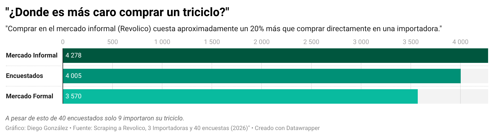
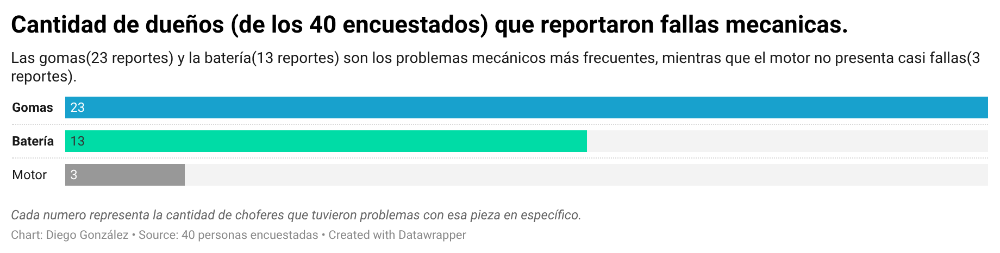
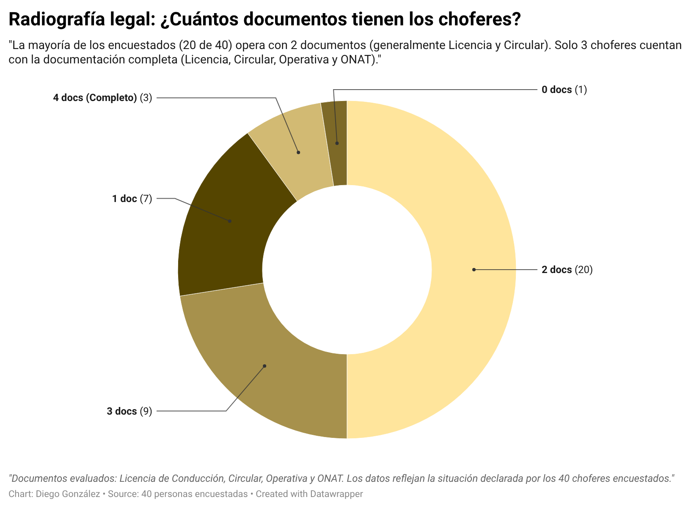
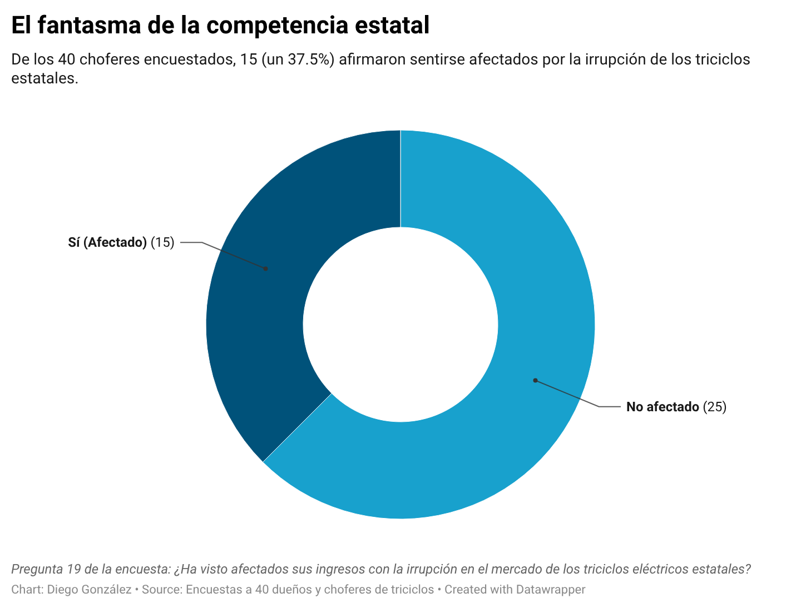
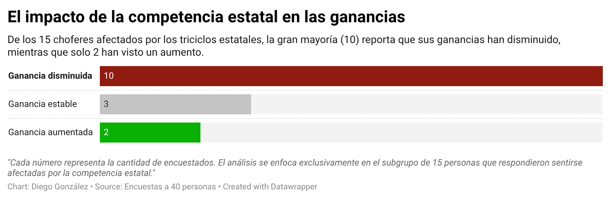
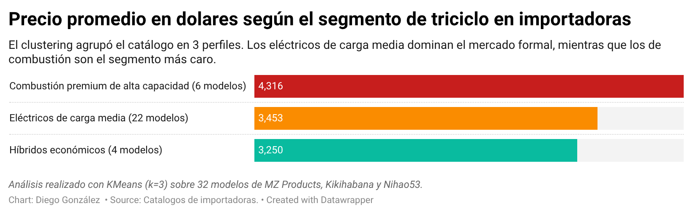
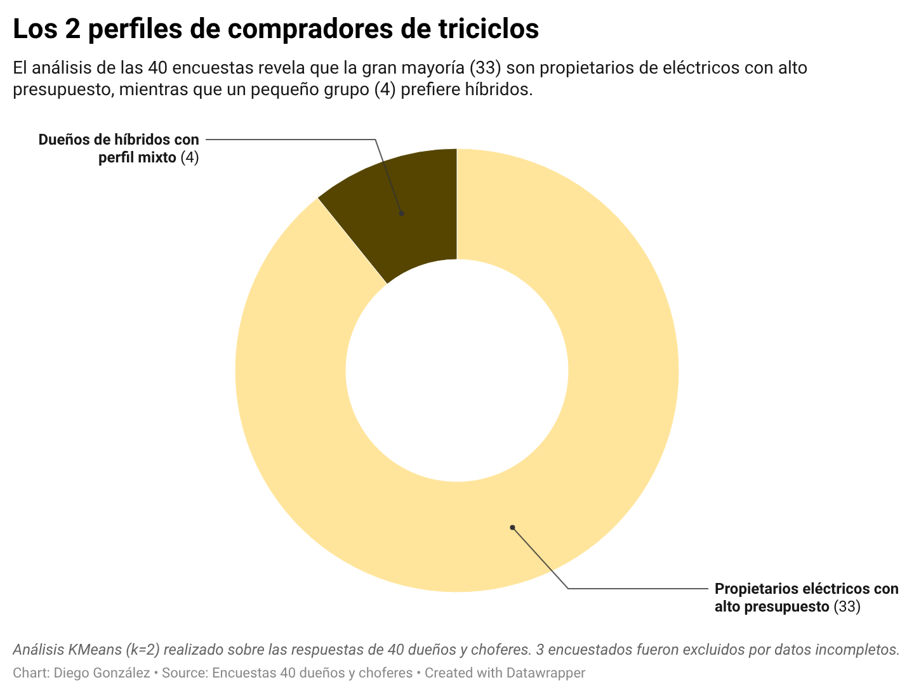
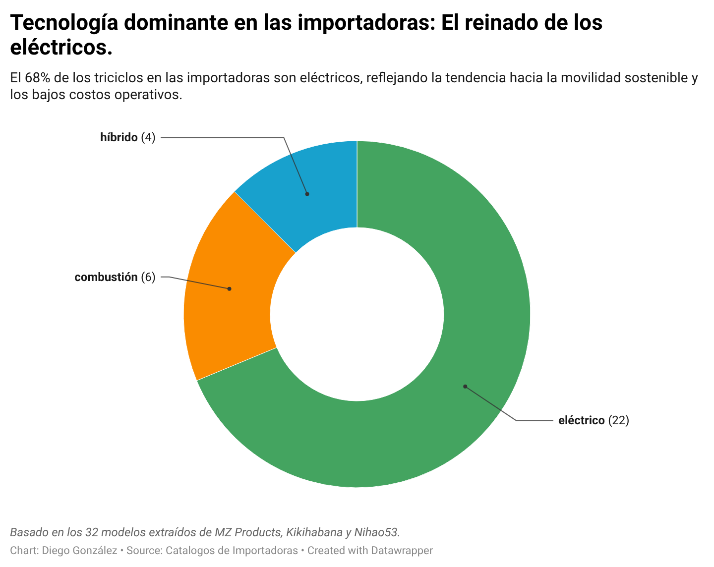

# 🛺 ¿Cuál es el triciclo indicado? Estudio de mercado de triciclos en Cuba

[](https://www.python.org/downloads/)
[](LICENSE)
[](https://cual-es-el-triciclo-indicado.onrender.com)

> Proyecto de ciencia de datos que analiza el mercado formal e informal de triciclos en Cuba y ayuda a decidir qué modelo conviene según el presupuesto y el uso.

## 🌐 Demo en vivo

**Prueba la aplicación interactiva:** [cual-es-el-triciclo-indicado.onrender.com](https://cual-es-el-triciclo-indicado.onrender.com)

*Nota: si la app estuvo inactiva, puede tardar unos segundos en despertar.*

📄 **Reporte técnico completo:** [`docs/informe_final.md`](docs/informe_final.md)

---

## 📌 Introducción

Comprar un triciclo en Cuba es una decisión cara y con poca información comparable: los precios cambian mucho entre el mercado informal y las importadoras, y no está claro qué modelo conviene según el uso. Este proyecto reúne datos reales de ambos mercados, los complementa con encuestas a dueños y choferes, y los convierte en una aplicación que ayuda a explorar las opciones.

## 🎯 Objetivos

**Pregunta central:** ¿cuál es el triciclo más conveniente para comprar en Cuba según el presupuesto y el uso (pasajeros o carga)?

**Objetivo principal:** desarrollar una aplicación web interactiva que oriente la compra a partir de un análisis de datos reales del mercado informal (Revolico) y formal (importadoras), complementado con encuestas de campo.

## 📊 Hallazgos clave

| Hallazgo | Resultado |
|---|---|
| **Precios por fuente** | Precio medio de **$4,278 USD** en Revolico (precio pedido), **$4,005 USD** pagado según los encuestados y **$3,570 USD** en importadoras. Revolico es ~20 % más caro que las importadoras (o las importadoras ~17 % más baratas). No se controló por tipo ni marca |
| **Fallas más comunes** | Las **gomas** (23 de 40 reportes) y la **batería** (13). El motor casi no falla (3) |
| **Ingresos por modalidad** | Ingreso diario **bruto** medio: Carga 6,000 CUP/día (solo 2 respuestas), Pasaje Intermunicipal 4,750 (4 respuestas) y Pasaje Urbano 3,750 (16 respuestas). No incluye costos de mantenimiento, así que no es ganancia neta |
| **Segmentos de oferta** | KMeans agrupó los modelos de importadoras en 3 segmentos: Combustión Premium, Eléctricos de Carga Media e Híbridos Económicos |

### Gráficos










---

## 🗂️ Fuentes de datos

| Fuente | Método | Fecha | Cantidad |
|---|---|---|---|
| **Revolico** (mercado informal) | Scraping | Mediados de octubre de 2026 | 757 anuncios únicos (769 extraídos, 12 duplicados descartados). Todos en USD |
| **Importadoras** (mercado formal) | Scraping | 22 y 23 de octubre de 2026 | 32 modelos de 3 tiendas: MZ Products, Kikihabana y Nihao53 |
| **Encuestas de campo** | Cuestionario presencial anónimo, muestreo por conveniencia | Dos primeras semanas de octubre de 2026 | 40 respuestas válidas |

Encuestas por modalidad de uso: **Pasaje y carga** 18, **Pasaje Urbano** 16, **Pasaje Intermunicipal** 4 y **Carga** 2.

### Diccionario de datos (Revolico)

Archivo: `data/processed/triciclos_aceptados_normalizado.json`

| Columna | Descripción |
|---|---|
| `id` | Identificador del anuncio |
| `titulo` | Título del anuncio |
| `precio_publicado` | Precio del anuncio |
| `moneda_original` | Moneda en que se publicó |
| `tipo_triciclo` | Eléctrico, híbrido o combustión |
| `marca_detectada` | Marca identificada en el anuncio |
| `autonomia_km` | Autonomía declarada, en km |
| `ubicacion` | Ubicación publicada |
| `municipio` | Municipio |
| `enlace` | URL del anuncio |

---

## 🔬 Estructura del análisis

1. **Captura:** scraping de Revolico y de las tiendas importadoras (`scraping/`).
2. **Normalización:** limpieza, estandarización y deduplicación (`scripts/normalizar.py`).
3. **Análisis:** precios, fallas, ingresos y comparación entre mercados (`scripts/`).
4. **Clustering:** segmentación de la oferta y de los compradores con KMeans (`scripts/clustering.py`).
5. **Presentación:** gráficos en `docs/` y aplicación web en `app/`.

El detalle de cada paso, los criterios de depuración y las limitaciones están en el [reporte técnico](docs/informe_final.md).

## 📂 Estructura del repositorio

├── app/ # Aplicación web (Streamlit)
├── data/ # Datos crudos (raw/) y procesados (processed/)
├── docs/ # Reporte técnico y gráficos
├── graficos/ # Gráficos generados
├── models/ # Espacio reservado para futuros modelos
├── scraping/ # Scripts y datos de la extracción web
├── scripts/ # Normalización, análisis y clustering
├── requirements.txt
├── LICENSE
└── README.md

## 🚀 Cómo ejecutar

```bash
# 1. Instalar dependencias
pip install -r requirements.txt

# 2. Normalizar los datos
python scripts/normalizar.py --aplicar

# 3. Lanzar la aplicación
streamlit run app/streamlit_app.py
⚠️ Limitaciones
Encuestas: 40 respuestas por muestreo por conveniencia; no representan a todo el país. Los grupos por modalidad son muy desiguales (Carga tiene solo 2 y Pasaje Intermunicipal 4), por lo que sus resultados son indicativos.

Scraping: cubre 90 de 253 páginas de Revolico, principalmente La Habana, Artemisa, Matanzas y Holguín.

Precios publicados: los de Revolico son los pedidos por el vendedor, no necesariamente los de venta final.

Comparación de mercados: la brecha del 20 % compara medias sin controlar por tipo ni marca de triciclo, y no se calcularon medianas.

Ingresos: son ingresos brutos reportados; no se recogieron costos de mantenimiento ni pago a ayudantes, por lo que no hay ganancia neta.

Catálogo de importadoras: no todos los modelos declaran autonomía y capacidad.

🛡️ Datos y privacidad
Solo se usan anuncios de acceso público. Las encuestas son anónimas y sus resultados se presentan de forma agregada.

📄 Licencia
Distribuido bajo licencia MIT. Consulta el archivo LICENSE.

👤 Autor
Diego Miguel González Marín
Proyecto de la asignatura Introducción a la Ciencia de Datos, 2026.
