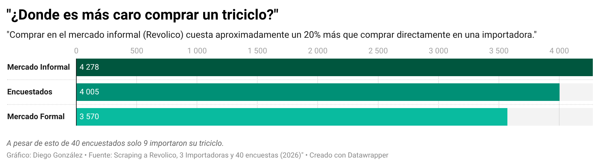
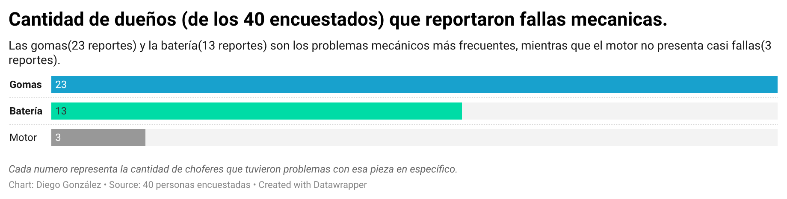
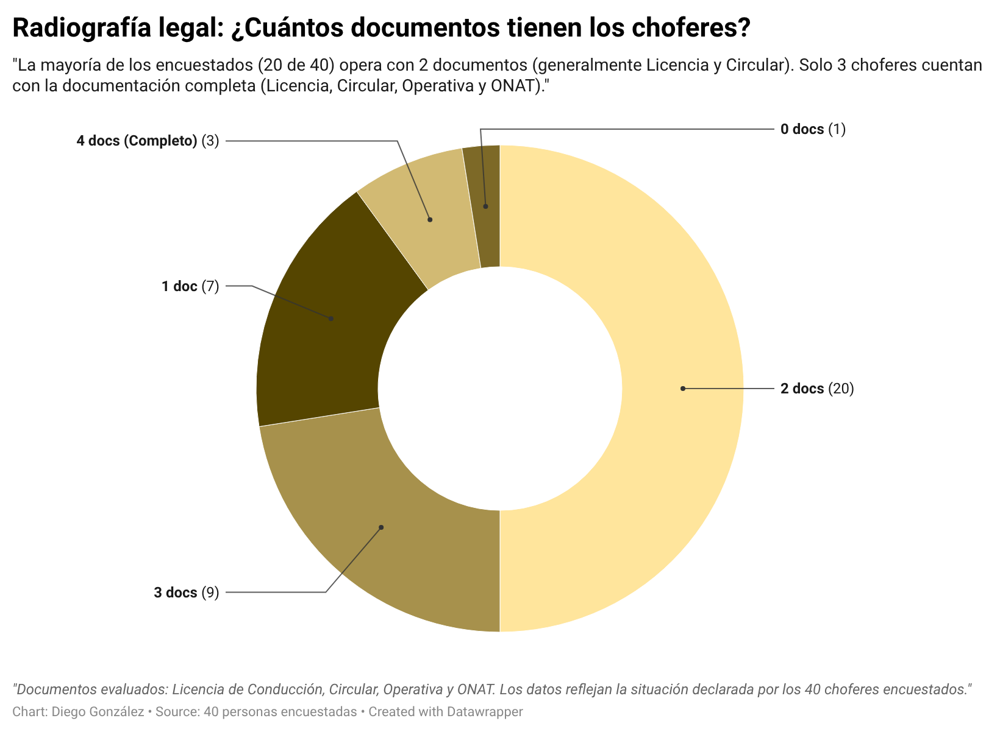
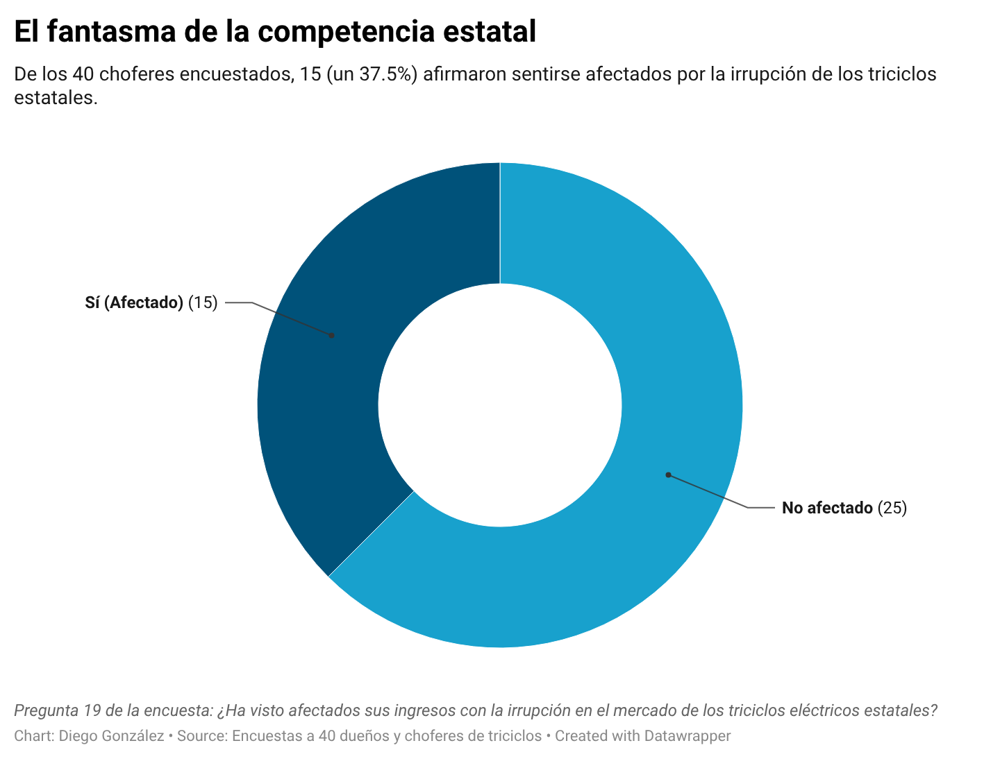
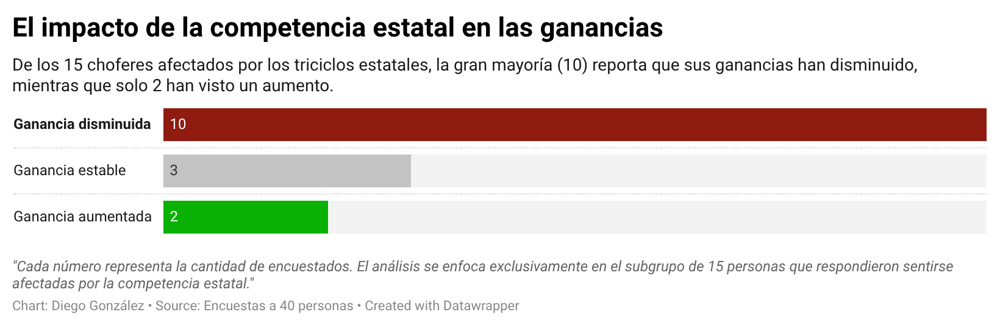
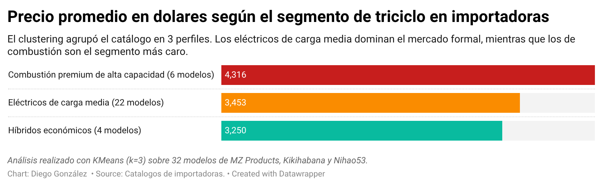
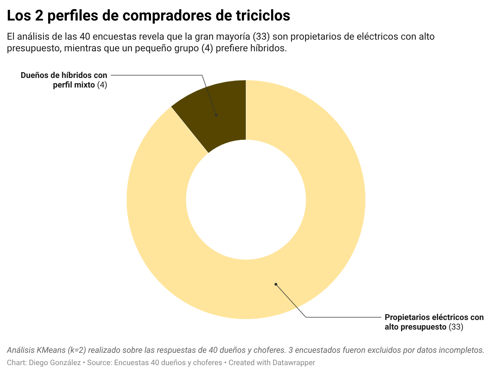
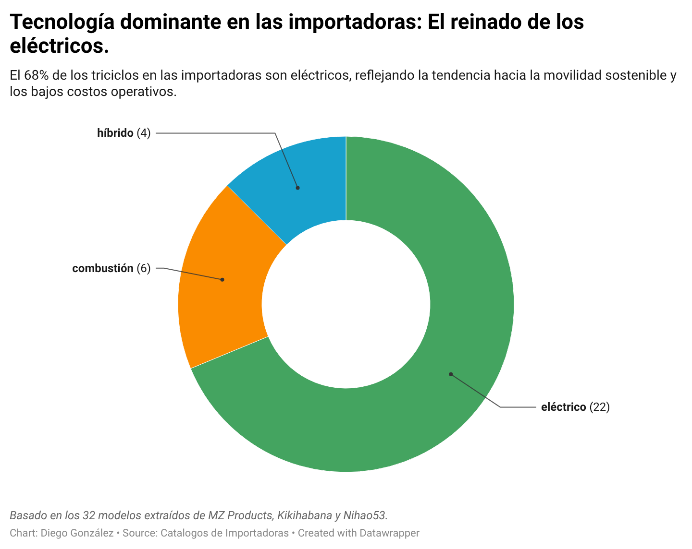

# Reporte técnico: ¿Cuál es el triciclo indicado? Estudio de mercado de triciclos en Cuba

**Autor:** Diego Miguel González Marín · **Asignatura:** Introducción a la Ciencia de Datos · **Fecha:** noviembre de 2026
**Repositorio:** [github.com/diegoglez122/-Cual-es-el-triciclo-indicado-](https://github.com/diegoglez122/-Cual-es-el-triciclo-indicado-) · **Aplicación:** [cual-es-el-triciclo-indicado.onrender.com](https://cual-es-el-triciclo-indicado.onrender.com)

## Tabla de contenidos

1. Introducción
2. Objetivos del proyecto
3. Fuentes de datos
4. Estructura del análisis
5. Resultados obtenidos
6. Conclusiones
7. ¿Cómo ejecutar el proyecto?
8. Notas finales y limitaciones

## Resumen

Este reporte analiza el mercado de triciclos en Cuba con tres fuentes: anuncios de Revolico (757 anuncios únicos), el catálogo de tres importadoras (32 modelos) y 40 encuestas de campo a dueños y choferes. Los precios medios son de **$4,278 USD** en Revolico, **$4,005 USD** pagados según los encuestados y **$3,570 USD** en importadoras. El ingreso bruto diario reportado más alto corresponde a Carga (6,000 CUP/día), pero se basa en solo 2 respuestas, y las gomas son la falla más citada. Los resultados describen precios publicados y una muestra pequeña, y deben leerse junto con las limitaciones de la sección 8.

## 1. Introducción

Comprar un triciclo para trabajar es una decisión de inversión importante en Cuba, y quien la toma tiene poca información comparable: los precios cambian mucho entre el mercado informal y las importadoras, y no está claro qué tipo conviene según el uso.

Este estudio reúne anuncios publicados en Revolico (obtenidos por web scraping), el catálogo de importadoras y encuestas de campo. Los datos se procesan siguiendo el pipeline de la asignatura: capturar, preprocesar, estructurar, procesar, analizar y presentar. Se compara la oferta informal con la formal y se describen los ingresos según la modalidad de uso (Pasaje Urbano, Pasaje Intermunicipal, Carga y la modalidad mixta de Pasaje y carga). Se consideran triciclos eléctricos, de combustión e híbridos, y se ofrece una aplicación web para explorar el mercado.

**Pregunta central:** ¿cuál es el triciclo más conveniente para comprar en Cuba según el presupuesto y el uso (pasajeros o carga)?

## 2. Objetivos del proyecto

### 2.1 Objetivo principal

Identificar qué tipo de triciclo resulta más conveniente comprar en Cuba según el uso previsto, comparando precios, características e ingresos reportados, y ofrecer una herramienta interactiva que oriente la decisión de compra.

### 2.2 Objetivos secundarios

- Caracterizar los precios del mercado informal (Revolico) y compararlos con los del mercado formal (importadoras).
- Comparar los ingresos diarios reportados según la modalidad de uso (carga y pasaje).
- Describir las variables de la oferta: tipo (eléctrico, híbrido, combustión), marca, autonomía y capacidad de carga.
- Analizar fallas mecánicas, costos reportados y nivel de formalidad legal según los trabajadores.
- Publicar los resultados en una aplicación web gratuita y reproducible.

## 3. Fuentes de datos

| Fuente | Método | Fecha de recogida | Cantidad | Unidad de análisis |
|---|---|---|---|---|
| **Revolico** (mercado informal) | Web scraping | Mediados de octubre de 2026 | 769 extraídos; 757 anuncios únicos | Un anuncio |
| **Importadoras** (mercado formal) | Web scraping | 22 y 23 de octubre de 2026 | 32 modelos de 3 tiendas (MZ Products, Kikihabana, Nihao53) | Un modelo del catálogo |
| **Encuestas de campo** | Cuestionario presencial | Dos primeras semanas de octubre de 2026 | 40 respuestas válidas | Una respuesta de un dueño o chofer |

**Revolico.** Los anuncios incluidos tienen fecha desde el 8 de octubre de 2026. Todos los precios están en USD. Los anuncios cubren principalmente La Habana, Artemisa, Matanzas y Holguín.

**Importadoras.** Cada modelo incluye tipo, precio y, cuando se declara, capacidad y autonomía.

**Encuestas.** Se hicieron por muestreo por conveniencia: se entrevistó a choferes y dueños que estaban trabajando en paradas de pasajeros y zonas de carga. Fueron anónimas: no se recogieron nombres ni datos personales, solo un identificador de encuesta.

Cantidad de encuestas por modalidad de uso:

| Modalidad | Encuestas |
|---|---|
| Pasaje y carga (mixto) | 18 |
| Pasaje Urbano | 16 |
| Pasaje Intermunicipal | 4 |
| Carga | 2 |
| **Total** | **40** |

Las modalidades Pasaje Intermunicipal (4) y Carga (2) tienen muy pocas respuestas, por lo que sus resultados son indicativos y no permiten comparaciones sólidas.

## 4. Estructura del análisis

### 4.1 Alcance y unidad de análisis

El estudio describe **precios publicados** (Revolico y catálogo) y **precios declarados como pagados** (encuestas). No mide ventas reales. Las tres fuentes tienen unidades distintas (anuncio, modelo y respuesta), por lo que sus conteos no se suman entre sí.

### 4.2 Recolección

- **Revolico:** extracción automática de anuncios. El scraping cubre **90 de 253 páginas**, por lo que la muestra no es el total del mercado.
- **Importadoras:** extracción del catálogo de las tres tiendas.
- **Encuestas:** trabajo de campo directo, descrito en la sección 3.

Solo se recogieron datos visibles públicamente.

### 4.3 Depuración y validación

- **Deduplicación en Revolico:** de 769 registros extraídos se descartaron **12 duplicados** y quedaron 757 anuncios únicos. Se consideró duplicado un anuncio que coincide en el identificador de su foto y en el teléfono del vendedor con otro, es decir, el mismo triciclo publicado dos veces. Esos dos campos se usan solo para detectar duplicados y no se publican.
- **Esquemas de validación:** los archivos `triciclo_aceptado_schema.json` y `triciclo_descartado_schema.json` definen los campos obligatorios para aceptar o descartar un anuncio.
- **Normalización:** los datos crudos tenían inconsistencias de escritura (por ejemplo, «Rali» y «Raly») y formatos mezclados (rangos de autonomía como «120-180 km»). Se corrigieron con scripts basados en expresiones regulares.
- **Validación pendiente:** no se hizo una revisión manual de una muestra de anuncios para medir los errores de la extracción automática. Esto se declara como limitación.

### 4.4 Estandarización y criterios de comparabilidad

- **Moneda:** los precios de vehículos se mantienen en USD y los ingresos diarios en CUP. No se hizo conversión entre ambas monedas. La encuesta registra la tasa de cambio del día (columna `tc_usd_cup`, referencia de elTOQUE), pero no se usó para convertir.
- **Comparación de precios entre fuentes:** los precios de Revolico son precios pedidos, los del catálogo son precios de tienda y los de las encuestas son precios que dicen haber pagado los encuestados. No se controló por tipo, marca ni estado del triciclo, así que las diferencias entre fuentes son descriptivas y no prueban que una fuente sea más cara que otra a igualdad de producto.
- **Comparación por tipo:** el catálogo formal se compara por tipo (combustión, eléctrico, híbrido).

### 4.5 Indicadores

| Indicador | Cálculo | Unidad |
|---|---|---|
| Precio medio por fuente | Media aritmética | USD |
| Precio medio por tipo (catálogo) | Media aritmética por tipo | USD |
| Ingreso diario bruto por modalidad | Media de lo reportado en la encuesta | CUP/día |
| Fallas | Número de reportes por componente | Reportes de 40 |
| Formalidad | Documentos legales con que opera cada encuestado | Documentos |
| Segmentos | KMeans: 3 segmentos en la oferta formal y 2 perfiles de compradores | Grupos |

Se usan medias. No se calcularon medianas, por lo que los promedios pueden estar influidos por valores extremos.

### 4.6 Estructura de los datos y del código

**Datos**

- `data/raw/`: anuncios tal como salieron del scraping y encuestas sin modificar.
- `data/processed/triciclos_aceptados_normalizado.json`: 757 anuncios únicos. Esquema: `id`, `titulo`, `precio_publicado`, `moneda_original`, `marca_detectada`, `tipo_triciclo`, `ubicacion`, `municipio`, `autonomia_km`, `enlace`.
- `catalogo_consolidado.csv`: registro unificado de los 32 modelos de importadoras.
- `encuestas.json`: respuestas estructuradas y validadas de las 40 encuestas.

**Código**

- `scraping/`: scripts de extracción web.
- `scripts/`: pipeline de análisis (`normalizar.py`, `clustering.py`, `insights_encuestas.py`, entre otros).
- `docs/`: informes y gráficos finales.
- `app/`: aplicación web en Streamlit.

### 4.7 Aplicación web

Desarrollada con Streamlit y desplegada gratis en Render: [cual-es-el-triciclo-indicado.onrender.com](https://cual-es-el-triciclo-indicado.onrender.com). Permite alternar entre buscar en Importadoras o en Revolico y filtrar por presupuesto, tipo de triciclo, uso y provincia.

### 4.8 Retos técnicos superados

- **Limpieza y normalización:** descrita en la sección 4.3.
- **Despliegue:** el primer intento en Streamlit Cloud falló por falta de memoria al compilar librerías pesadas como `scipy` en versiones muy recientes de Python. Se resolvió separando las dependencias de desarrollo en `requirements-dev.txt` y dejando en `requirements.txt` solo las de producción (`streamlit` y `pandas`).

### 4.9 Privacidad y herramientas

- **Privacidad:** los datos de Revolico son anuncios de acceso público. Las encuestas son anónimas y se presentan solo de forma agregada.
- **Herramientas:** el procesamiento se hizo en Python 3.11. Los programas se desarrollaron con ayuda de asistentes de inteligencia artificial (entre ellos OpenCode y Claude), a partir de las decisiones del autor.

## 5. Resultados obtenidos

### 5.1 Precios por fuente

| Fuente | Precio medio (USD) |
|---|---|
| Revolico (precio pedido) | 4,278 |
| Encuestas (precio pagado, declarado) | 4,005 |
| Importadoras (precio de catálogo) | 3,570 |

El precio medio de Revolico es alrededor de un 20 % superior al de las importadoras. Dicho al revés, las importadoras son cerca de un 17 % más baratas. Ver la sección 4.4 sobre los límites de esta comparación.

### 5.2 Oferta formal por tipo

| Tipo | Precio medio (USD) |
|---|---|
| Combustión | 4,316 |
| Eléctrico | 3,453 |
| Híbrido | 3,249 |

Alrededor de dos tercios de la oferta formal es eléctrica. Los modelos de combustión tienen la mayor capacidad de carga (hasta 2,000 kg) y los eléctricos promedian 660 kg. La autonomía no está declarada en todos los modelos del catálogo, por lo que no se comparan autonomías entre tipos.

### 5.3 Ingresos por modalidad de uso

| Modalidad | Encuestas (n) | Ingreso diario bruto medio (CUP/día) |
|---|---|---|
| Carga | 2 | 6,000 |
| Pasaje Intermunicipal | 4 | 4,750 |
| Pasaje Urbano | 16 | 3,750 |

Con 2 respuestas en Carga y 4 en Pasaje Intermunicipal, las medias de esos grupos pueden cambiar mucho con una sola respuesta. La modalidad mixta de Pasaje y carga (18 respuestas, el grupo más numeroso) no se incluye en esta tabla porque su ingreso medio no se calculó en esta versión del análisis.

Son **ingresos brutos reportados**, no ganancias. La encuesta recogió ingreso diario bruto, gasto mensual de electricidad y días trabajados por semana, pero no recogió costos de mantenimiento ni pago a ayudantes. Por eso no es posible calcular una ganancia neta ni el tiempo de recuperación de la inversión.

### 5.4 Fallas y formalidad

- Las fallas más reportadas son las **gomas** (23 de 40 reportes) y la **batería** (13). El motor casi no falla (3).
- La mayoría de los choferes opera con solo **2 documentos** legales.
- Las fallas no se cruzaron por modalidad de uso, así que no se puede afirmar qué modalidad sufre más desgaste.

### 5.5 Competencia estatal

El 37.5 % de los encuestados dice sentirse afectado por los triciclos estatales (15 de 40). De ellos, dos de cada tres reportan que sus ganancias han disminuido.

### 5.6 Segmentación (KMeans)

- **Oferta formal:** tres segmentos: Combustión Premium, Eléctricos de Carga Media e Híbridos Económicos.
- **Compradores:** dos perfiles: propietarios de triciclos eléctricos de alto presupuesto (89 %) y dueños de híbridos de uso mixto (11 %). Los porcentajes se calcularon sobre las respuestas usadas en el clustering. El segundo perfil es un grupo de muy pocas personas, así que debe leerse con cautela.

### 5.7 Visualizaciones

## 6. Conclusiones

Los datos describen un mercado donde el precio medio pedido en Revolico es alrededor de un 20 % superior al de las importadoras, y donde los encuestados dicen haber pagado un precio intermedio. Una posible explicación es el acceso limitado a divisas y trámites de importación, pero este estudio no lo mide y debe tomarse como hipótesis para trabajos futuros.

Por modalidad, **Carga** muestra el mayor ingreso bruto diario (6,000 CUP/día), por delante de Pasaje Intermunicipal (4,750) y Pasaje Urbano (3,750). Sin embargo, Carga se basa en solo 2 respuestas y Pasaje Intermunicipal en 4, así que este resultado es una señal y no una conclusión firme. Además, mayor ingreso bruto no equivale a mayor ganancia: no se recogieron costos de mantenimiento ni pago a ayudantes, y las gomas y la batería son las fallas más citadas en el conjunto de la muestra.

En la oferta formal, los modelos eléctricos son los más numerosos y tienen un precio medio inferior al de combustión, y los de combustión ofrecen la mayor capacidad de carga. Para decidir una compra, estos datos sirven como referencia de precios y de uso, no como una recomendación única. La aplicación web permite explorar las opciones según presupuesto, tipo, uso y provincia.

El alto nivel de informalidad documental (la mayoría opera con solo 2 documentos) y la percepción de competencia estatal aparecen como los principales desafíos reportados por los encuestados.

## 7. ¿Cómo ejecutar el proyecto?

### 7.1 Requisitos

- Python 3.11
- Las librerías de `requirements.txt`

### 7.2 Pasos

1. Instalar dependencias: `pip install -r requirements.txt`
2. Ejecutar la normalización de datos: `python scripts/normalizar.py --aplicar`
3. Lanzar la aplicación: `streamlit run app/streamlit_app.py`

## 8. Notas finales y limitaciones

- Los precios de Revolico son precios publicados (de oferta), no necesariamente de venta final.
- El scraping de Revolico cubre 90 de 253 páginas y principalmente La Habana, Artemisa, Matanzas y Holguín; no representa a todo el país.
- Las encuestas son una muestra por conveniencia de 40 personas: no permiten generalizar a nivel nacional.
- Los grupos por modalidad son desiguales: Pasaje y carga (18), Pasaje Urbano (16), Pasaje Intermunicipal (4) y Carga (2). Las comparaciones que involucran los dos grupos pequeños son solo indicativas, y el ingreso de la modalidad mixta no se analizó en esta versión.
- No se dividió el análisis por municipio ni provincia por falta de tiempo y datos suficientes.
- No se calcularon medianas ni se controló por tipo y marca al comparar precios entre fuentes.
- No se recogieron costos de mantenimiento ni pago a ayudantes, por lo que no hay ganancia neta.
- La extracción automática de datos no se validó con una revisión manual de muestra.
- Datos incompletos en el catálogo de importadoras: no todos los modelos declaran autonomía y capacidad.

Código y datos: [github.com/diegoglez122/-Cual-es-el-triciclo-indicado-](https://github.com/diegoglez122/-Cual-es-el-triciclo-indicado-)
